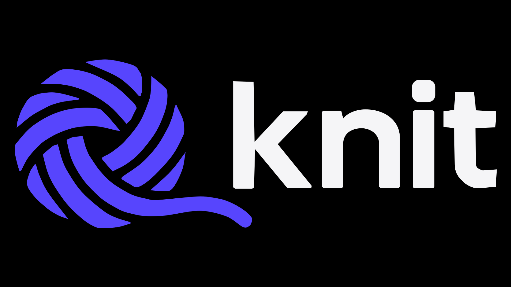

<p align="center">
  
</p>

# knit

**A version control system and a from-scratch alternative to Git.**

knit is a version control system written in Rust by [Axiom](https://github.com/axiomwtf). The whole repository lives in a single `.knit` file. There is no staging area: `knit tie` snapshots the working tree directly. Every knot is signed with Ed25519.

> **Status:** `0.1.0` - early development.

## Why

- **One file.** The entire repository - objects, strands, marks, stashes, hubs, stat cache - is a single append-only `.knit` file. No `.git` directory, no sidecars, no index.
- **No staging area.** `knit tie` commits the working tree as it stands. What you see is what gets knotted.
- **Every knot signed.** Each commit carries an Ed25519 signature over its canonical encoding. `knit pick` verifies it against the yarnball's known keys.
- **Git-compatible objects.** Trees, blobs and modes map onto the same model Git uses, so `knit pickup` imports real repositories - loose objects and packfiles with delta chains included - without shelling out to git.
- **Yarn vocabulary.** Commits are knots, branches are strands, merges are joins, conflicts are snags. `knit count`, `knit rows`, `knit shear`, `knit pick`.
- **Knits remotes.** `knit hub`/`send`/`gather`/`haul` sync yarnballs over ssh (`knits` stdio daemon) or straight to GitHub through `gh api` - no git involved on either side.

## Example

```bash
knit key gen                    # one-time: Ed25519 identity in ~/.config/knit/
knit cast-on [dir]              # create a yarnball (.knit file)
knit tie -knot "title" -yarn "description"   # snapshot the working tree
knit count                     # working-tree changes since last knot
knit rows                      # list knots on the current strand
knit shear                     # diff working tree vs HEAD
knit pick <knot>               # inspect a knot (verifies signature)
knit strand dev && knit switch dev           # branch and switch
knit join feature              # three-way merge; conflicts become snags
knit mark v1.0                 # name a knot
knit stash "wip"               # set work aside; stash list / stash pop
knit pickup /path/to/repo      # import a git repo (worktree, .git, or bare)

knit hub add github github.com/you/repo
knit send github               # push source + .knit via gh api
knit gather github             # pull remote objects and strands
knit haul github               # gather, then join the remote head strand
```

`.noyarn` files mark ignored paths (gitignore syntax). `~/.config/knit/ignore` is the global ignore.

## Commands

```bash
# core
knit cast-on [dir]             # init a yarnball
knit tie [-knot T] [-yarn D] [-e]   # snapshot the working tree (aliases: knot, save)
knit count                     # status
knit rows [strand]            # log / show history
knit shear [knot|a b]          # diff
knit pick <knot>               # show one knot, verify signature

# strands and history
knit strand [name]             # list / create strands
knit switch <strand>           # change the active strand
knit join <strand>             # merge a strand in
knit frog <knot>               # revert a knot
knit lift <knot>               # cherry-pick one knot
knit mark [name] [knot] [-d]   # tags
knit track <file>              # blame: knots that touched a file
knit loom <strand> <dir>       # worktree (read-only)
knit block                     # compact the yarnball
knit sweep                     # remove untracked files
knit stash [label]|list|pop    # stash

# remotes
knit hub add|list|remove       # manage Knits
knit pickup <path>             # clone/import a git repo
knit send <hub>                # push
knit gather <hub>              # fetch
knit haul <hub>                # pull = gather + join
knit key gen|show              # Ed25519 identity
```

Hub urls: `github.com/owner/repo` (via `gh api`), `file:///dir`, `/dir`, or `user@host[:dir]` (ssh, remote runs `knits`).

## Format

A `.knit` file is a 32-byte header followed by length-prefixed, CRC32-protected record frames. Readers tolerate a torn tail; writers hold `flock` on the file itself. Object records (`BLOB`/`TREE`/`KNOT`) are content-addressed with blake3; state records (`REF`/`HEAD`/`INDEX`/`MARK`/`STASH`/`HUB`/`JOIN`/`KEY`) are append-only logs where the latest wins. The full spec is in [`FORMAT.md`](./FORMAT.md).

## Building from source

knit is written in Rust and lives in [`src/`](./src). It builds two binaries: `knit` (the CLI) and `knits` (the stdio remote daemon).

```bash
cargo build --release
```

The binaries are `target/release/knit` and `target/release/knits`.

## Spec

The product specification is `knitspec.md` in the parent directory of this repo's source tree; the file format is [`FORMAT.md`](./FORMAT.md).

## License

MPL-2.0
